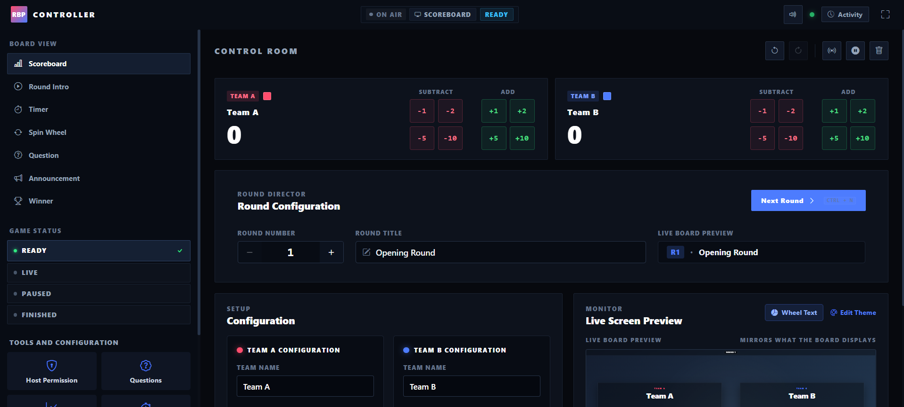
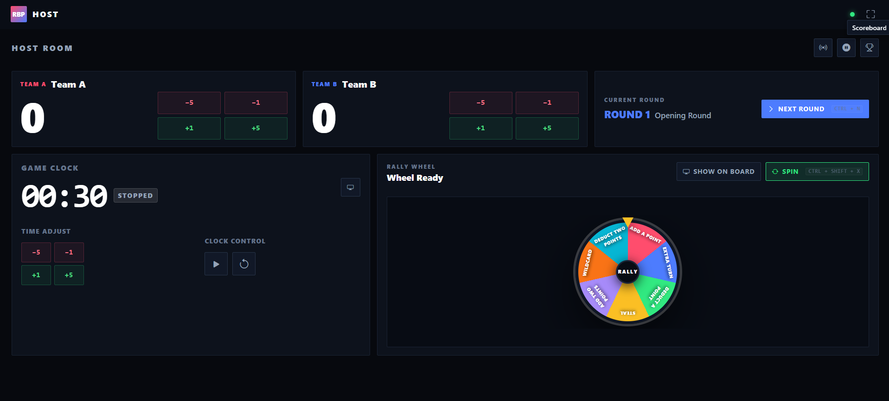
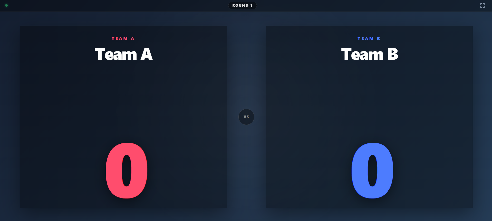

# Rally Board Pilot

RBP is a two-team game-show control and scoreboard system.

It gives you three separate screens: **Controller**, **Host**, and **Game Board**. They all stay in sync using Socket.IO.

---

## Stack

[](https://react.dev/)
[](https://vite.dev/)
[](https://getbootstrap.com/)
[](https://nodejs.org/)
[](https://expressjs.com/)
[](https://socket.io/)
[](https://developer.mozilla.org/en-US/docs/Web/CSS)

### Screenshots

**Controller** — Full operator console



**Host** — Live game console for a co-presenter



**Game Board** — Public display for the audience



---

## What It Does

RBP has three screens:

- **Controller** — full control of the game
- **Host** — simple controls for the person running the game
- **Game Board** — the public display for players and the audience

---

## Architecture

```text
                         ┌─────────────────────┐
                         │     Controller      │
                         │  Full Game Control  │
                         └──────────┬──────────┘
                                    │
                                    │ Socket.IO
                                    ▼
                         ┌─────────────────────┐
                         │    Node / Express   │
                         │   Game State        │
                         │   Socket.IO         │
                         └──────────┬──────────┘
                                    │
                                    │ Socket.IO
                                    ▼
                         ┌─────────────────────┐
                         │     Game Board      │
                         │   Public Display    │
                         └─────────────────────┘

                         ┌─────────────────────┐
                         │        Host         │
                         │  Limited Controls   │
                         └──────────┬──────────┘
                                    │
                                    │ Socket.IO
                                    ▼
                         ┌─────────────────────┐
                         │    Node / Express   │
                         └─────────────────────┘
```

### How State Updates Flow

```text
Controller / Host
       │
       │ Game Action
       ▼
Socket.IO Server
       │
       │ Update State
       ▼
In-Memory Game State
       │
       │ Broadcast
       ▼
All Connected Clients
       │
       ├── Controller
       ├── Host
       └── Game Board
```

---

## The Three Screens

### Controller — `/controller`

The main operator screen. Full control.

**What you can do:**

- Add and subtract points
- Change team names and colours
- Manage rounds
- Change game status
- Switch board pages
- Change the theme
- Reset the game
- View the live board preview
- View the activity log
- Control the timer
- Control the spin wheel
- Send announcements
- Show the winner

---

### Host — `/host`

A simpler screen for the person presenting the game live.

**What you can do:**

- Score controls
- Round controls
- Game status controls
- Spin wheel controls

The Host does not need the full Controller setup.

---

### Game Board — `/board`

The public display. Put this on a projector, TV, or big screen.

**Board pages:**

- Scoreboard
- Round Intro
- Timer
- Spin Wheel
- Announcement
- Winner

The board updates automatically when the Controller or Host makes a change.

---

## Requirements

Before running RBP, you need:

- Node.js
- npm
- Git

Check your versions:

```bash
node --version
npm --version
```

---

## Installation

Clone the repo:

```bash
git clone <your-repository-url>
cd rally_board_pilot
```

Install dependencies:

```bash
npm install
```

---

## Environment Setup

Copy the example file:

```bash
cp .env.example .env
```

The `.env` file looks like this:

```env
PORT=3001
CLIENT_ORIGIN=http://localhost:5173
VITE_SERVER_URL=http://localhost:3001
```

Do not commit your `.env` file to Git.

---

## Running the App

### Quickest Way — Makefile

```bash
make dev
```

### Or with npm

```bash
npm run dev
```

---

## URLs

| Screen             | URL                                       |
|--------------------|-------------------------------------------|
| Landing page       | `http://localhost:5173`                   |
| Controller         | `http://localhost:5173/controller`        |
| Host               | `http://localhost:5173/host`              |
| Game Board         | `http://localhost:5173/board`             |
| Server health      | `http://localhost:3001/api/health`        |
| Game state         | `http://localhost:3001/api/game-state`    |

---

## Workflow

```text
1. Start the server
       ↓
2. Open Game Board on the display screen
       ↓
3. Open Controller in your browser
       ↓
4. Set up teams
       ↓
5. Pick the active board page
       ↓
6. Start the game
       ↓
7. Control scores and rounds
       ↓
8. Use Timer, Wheel, or Announcements
       ↓
9. Show the Winner
```

---

## API

### Health Check

```http
GET /api/health
```

```json
{
  "success": true,
  "system": "Rally Board Pilot",
  "status": "online"
}
```

### Game State

```http
GET /api/game-state
```

Returns the current game state from the server.

---

## Socket Events

RBP uses these Socket.IO events:

```text
SCORE_ADJUST
SET_TEAM
SET_PAGE
SET_ROUND
SET_STATUS
SET_THEME
TIMER_SET
TIMER_START
TIMER_PAUSE
TIMER_RESET
WHEEL_SET_ENTRIES
WHEEL_SPIN
WHEEL_CLEAR_RESULT
ANNOUNCEMENT_SET
ANNOUNCEMENT_CLEAR
RESET_GAME
```

---

## Production Build

Build the app:

```bash
npm run build
```

Preview it:

```bash
npm run preview
```

Start the server:

```bash
npm start
```

---

## Design Goal

RBP is designed to feel like a **broadcast / game-show control room** — not a normal admin panel.

It focuses on:

- Fast controls
- Big, easy-to-read game info
- Clear team identity
- Instant feedback
- Clean display pages
- No friction during a live event
- Separation between operator controls and public display

---

## Version Note

RBP V1 uses **in-memory state** — no database needed.

The game state is lost when the server restarts. Future versions may add persistence.

---

## Future Plans

- Persistent game sessions
- Multiple game rooms
- Room codes
- Saved themes
- Saved wheel presets
- Sound effects
- Multiple teams
- Authentication
- Database

---

## License

See `LICENSE` file.
